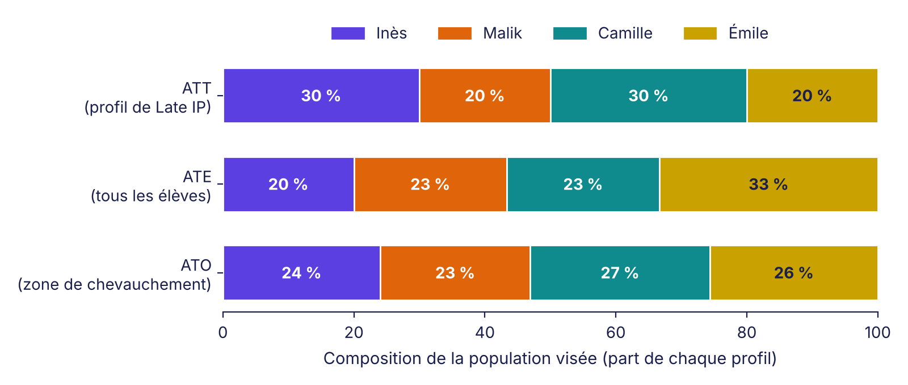

::: {.callout-note}
## La suite de l'histoire de Nadia et Louis
Cet article prolonge [le premier](../ponderation-trajectoires-pi/index.qmd) et [le deuxième](../incertitude-ponderation/index.qmd). Les élèves sont toujours les mêmes, inventés comme leurs chiffres : [le fichier se télécharge ici (CSV)](../ponderation-trajectoires-pi/eleves-simules.csv). Tous les calculs sont écrits en entier, pour pouvoir les refaire à la main.
:::

::: {.callout-tip}
## Dico express
- **Population cible** : le groupe d'élèves à qui s'adresse la réponse.
- **ATT** : l'effet moyen chez les élèves du groupe focal (ici, Late IP).
- **ATE** : l'effet moyen si on considérait tous les élèves, quel que soit leur groupe.
- **ATO** : l'effet moyen chez les élèves qui auraient pu aller dans l'un ou l'autre groupe, ceux qui sont dans la « zone de chevauchement ».
- **Score de propension** : la chance, pour un élève de profil donné, de se retrouver dans un groupe plutôt que dans l'autre.
- **Poids** : le nombre de « voix » que compte chaque élève dans le calcul.
- **Appariement** : jumeler chaque élève du groupe focal à un élève du groupe comparé de score très proche, et écarter les autres.
:::

## La question que Louis n'avait pas posée

Dans le premier article, Nadia avait fait quelque chose sans l'expliquer. Elle avait modifié le poids des élèves de Never IP pour qu'ils ressemblent à ceux de Late IP. Louis s'en souvient, et il a fini par poser la question.

« Pourquoi les élèves de Never IP devaient-ils ressembler à ceux de Late IP? Pourquoi pas l'inverse? Ou pourquoi ne pas prendre tous les élèves ensemble? »

Nadia sourit. C'est la question qu'elle attendait.

« Parce que chaque choix répond à une question différente. Et la réponse change avec la question. »

## Trois populations, trois questions

Nadia écrit trois lignes au tableau.

| Nom | Question posée | Population visée |
|---|---|---|
| **ATT** | Chez des élèves comme ceux de Late IP, quel est l'écart avec Never IP? | Les élèves de Late IP, tels qu'ils sont |
| **ATE** | Si on considérait tous les élèves, quel serait l'écart? | Les 30 élèves de Late IP et de Never IP réunis |
| **ATO** | Chez les élèves qui auraient pu aller dans l'un ou l'autre groupe, quel est l'écart? | Les élèves des profils qu'on trouve à la fois dans les deux groupes |

« Dans les trois cas, je compare le pourcentage de diplômés de Late IP à celui de Never IP, explique Nadia. Ce qui change, c'est la photo de classe qu'on vise. Je retouche les deux groupes pour qu'ils ressemblent à cette photo. »

## Le matériel de départ

Elle ressort le tableau des quatre profils, pour les 30 élèves de Late IP et de Never IP (les 10 élèves de Early persistent IP ne comptent pas ici). Chaque case indique le nombre d'élèves, puis, entre parenthèses, le nombre de diplômés.

| Profil | Late IP | Never IP | Total |
|---|:-:|:-:|:-:|
| Inès (défavorisée et diagnostic) | 3 (1) | 3 (2) | 6 |
| Malik (défavorisé seulement) | 2 (1) | 5 (4) | 7 |
| Camille (diagnostic seulement) | 3 (2) | 4 (3) | 7 |
| Émile (aucun des deux) | 2 (2) | 8 (8) | 10 |
| **Total** | **10 (6)** | **20 (17)** | **30** |

Elle calcule ensuite le score de propension de chaque profil : parmi les élèves de ce profil, quelle part est en Late IP? Appelons ce score *s*. Sa version complémentaire, 1 − *s*, est la part en Never IP.

| Profil | Calcul de *s* | *s* (chance d'être en Late IP) | 1 − *s* (chance d'être en Never IP) |
|---|:-:|:-:|:-:|
| Inès | 3 ÷ (3 + 3) | 0,500 | 0,500 |
| Malik | 2 ÷ (2 + 5) | 0,286 | 0,714 |
| Camille | 3 ÷ (3 + 4) | 0,429 | 0,571 |
| Émile | 2 ÷ (2 + 8) | 0,200 | 0,800 |

Ce sont exactement les chiffres du chevauchement du premier article. La seule différence : on compare ici deux groupes, sans tenir compte de Early persistent IP.

« À partir de ce score, chaque question fabrique ses propres poids, dit Nadia. Et je te montrerai ensuite une quatrième approche, l'appariement, qui vise la même population que l'ATT sans passer par des poids. »

## Calcul 1 : l'ATT (ce qu'on a déjà fait)

**La règle.** Les élèves de Late IP gardent un poids de 1. Les élèves de Never IP reçoivent *s* ÷ (1 − *s*).

| Profil | Poids Never IP | Élèves Never IP | Poids total | Diplômés pondérés |
|---|:-:|:-:|:-:|:-:|
| Inès | 0,500 ÷ 0,500 = 1,00 | 3 | 3,00 | 2 × 1,00 = 2,00 |
| Malik | 0,286 ÷ 0,714 = 0,40 | 5 | 2,00 | 4 × 0,40 = 1,60 |
| Camille | 0,429 ÷ 0,571 = 0,75 | 4 | 3,00 | 3 × 0,75 = 2,25 |
| Émile | 0,200 ÷ 0,800 = 0,25 | 8 | 2,00 | 8 × 0,25 = 2,00 |
| **Total** | | **20** | **10,00** | **7,85** |

- Late IP : 6 diplômés sur 10, soit **60,0 %**.
- Never IP pondéré : 7,85 ÷ 10,00 = **78,5 %**.
- Rapport de risques : 0,600 ÷ 0,785 = **0,76**.

**La photo visée.** La composition de Late IP : 30 % d'Inès, 20 % de Malik, 30 % de Camille, 20 % d'Émile.

## Calcul 2 : l'ATE

**La règle.** Chaque élève reçoit 1 ÷ (sa chance d'être dans son propre groupe). Un élève de Late IP reçoit 1 ÷ *s*. Un élève de Never IP reçoit 1 ÷ (1 − *s*). Un profil rare dans son groupe compte donc beaucoup.

**Late IP.**

| Profil | Poids (1 ÷ *s*) | Élèves | Poids total | Diplômés pondérés |
|---|:-:|:-:|:-:|:-:|
| Inès | 1 ÷ 0,500 = 2,00 | 3 | 6,00 | 1 × 2,00 = 2,00 |
| Malik | 1 ÷ 0,286 = 3,50 | 2 | 7,00 | 1 × 3,50 = 3,50 |
| Camille | 1 ÷ 0,429 = 2,33 | 3 | 7,00 | 2 × 2,33 = 4,67 |
| Émile | 1 ÷ 0,200 = 5,00 | 2 | 10,00 | 2 × 5,00 = 10,00 |
| **Total** | | **10** | **30,00** | **20,17** |

**Never IP.**

| Profil | Poids (1 ÷ (1 − *s*)) | Élèves | Poids total | Diplômés pondérés |
|---|:-:|:-:|:-:|:-:|
| Inès | 1 ÷ 0,500 = 2,00 | 3 | 6,00 | 2 × 2,00 = 4,00 |
| Malik | 1 ÷ 0,714 = 1,40 | 5 | 7,00 | 4 × 1,40 = 5,60 |
| Camille | 1 ÷ 0,571 = 1,75 | 4 | 7,00 | 3 × 1,75 = 5,25 |
| Émile | 1 ÷ 0,800 = 1,25 | 8 | 10,00 | 8 × 1,25 = 10,00 |
| **Total** | | **20** | **30,00** | **24,85** |

- Late IP pondéré : 20,17 ÷ 30,00 = **67,2 %**.
- Never IP pondéré : 24,85 ÷ 30,00 = **82,8 %**.
- Rapport de risques : 0,672 ÷ 0,828 = **0,81**.

**Une vérification qui rassure.** Dans les deux groupes, le poids total de chaque profil (6, 7, 7 et 10) égale le nombre d'élèves de ce profil dans l'ensemble des 30 élèves. Les deux groupes ressemblent donc bien à la population entière.

**La photo visée.** La composition des 30 élèves : 20 % d'Inès, 23 % de Malik, 23 % de Camille, 33 % d'Émile.

## Calcul 3 : l'ATO

**La règle.** Un élève de Late IP reçoit 1 − *s* (la chance qu'il ait été en Never IP). Un élève de Never IP reçoit *s* (la chance qu'il ait été en Late IP). Un élève dont le profil est courant dans les deux groupes compte plus. Un profil presque absent d'un groupe compte peu.

**Late IP.**

| Profil | Poids (1 − *s*) | Élèves | Poids total | Diplômés pondérés |
|---|:-:|:-:|:-:|:-:|
| Inès | 0,500 | 3 | 1,50 | 1 × 0,500 = 0,50 |
| Malik | 0,714 | 2 | 1,43 | 1 × 0,714 = 0,71 |
| Camille | 0,571 | 3 | 1,71 | 2 × 0,571 = 1,14 |
| Émile | 0,800 | 2 | 1,60 | 2 × 0,800 = 1,60 |
| **Total** | | **10** | **6,24** | **3,96** |

**Never IP.**

| Profil | Poids (*s*) | Élèves | Poids total | Diplômés pondérés |
|---|:-:|:-:|:-:|:-:|
| Inès | 0,500 | 3 | 1,50 | 2 × 0,500 = 1,00 |
| Malik | 0,286 | 5 | 1,43 | 4 × 0,286 = 1,14 |
| Camille | 0,429 | 4 | 1,71 | 3 × 0,429 = 1,29 |
| Émile | 0,200 | 8 | 1,60 | 8 × 0,200 = 1,60 |
| **Total** | | **20** | **6,24** | **5,03** |

- Late IP pondéré : 3,96 ÷ 6,24 = **63,4 %**.
- Never IP pondéré : 5,03 ÷ 6,24 = **80,6 %**.
- Rapport de risques : 0,634 ÷ 0,806 = **0,79**.

**La photo visée.** 24 % d'Inès, 23 % de Malik, 27 % de Camille, 26 % d'Émile. Les poids ne dépassent jamais 1, donc aucun élève ne prend toute la place.

## Calcul 4 : l'appariement au plus proche voisin

Louis a une dernière question, celle qu'on pose toujours.

« J'ai déjà entendu parler de l'appariement. Pour chaque élève de Late IP, on trouve un jumeau dans Never IP. Ce n'est pas la même chose que la pondération?

— C'est une autre façon d'obtenir la même photo, répond Nadia. Elle vise la même population que l'ATT : les élèves de Late IP, tels qu'ils sont. Mais au lieu de donner un poids à chaque élève de Never IP, on en choisit certains et on écarte les autres. »

**La règle.**

1. On utilise le même score *s* que plus haut.
2. Pour chaque élève de Late IP, on cherche l'élève de Never IP dont le score est le plus proche. Ici, le score ne prend que quatre valeurs (0,500, 0,286, 0,429 et 0,200) : le plus proche voisin est donc un élève de Never IP du même profil.
3. Quand plusieurs jumeaux sont possibles, on en tire un au hasard. On travaille *sans remise* : un élève de Never IP ne peut servir qu'une fois.
4. Les élèves de Never IP qui n'ont pas été choisis sont écartés.

**Le jumelage, profil par profil.**

| Profil | Élèves de Late IP à jumeler | Élèves de Never IP disponibles (diplômés) | Jumeaux retenus | Diplômés parmi les jumeaux |
|---|:-:|:-:|:-:|:-:|
| Inès | 3 | 3 (2) | 3 sur 3 | 2 (certain) |
| Malik | 2 | 5 (4) | 2 sur 5 | 2 ou 1 |
| Camille | 3 | 4 (3) | 3 sur 4 | 3 ou 2 |
| Émile | 2 | 8 (8) | 2 sur 8 | 2 (certain) |
| **Total** | **10** | **20 (17)** | **10 sur 20** | **7, 8 ou 9** |

Chez Malik, il y a 10 façons de tirer 2 élèves parmi 5. Dans 6 d'entre elles, les deux jumeaux sont diplômés (4 diplômés parmi 5, soit 4 × 3 ÷ 2 = 6 paires). Il y a donc 60 % de chances d'obtenir 2 diplômés, et 40 % d'en obtenir 1. Chez Camille, il y a 4 façons de tirer 3 élèves parmi 4. Dans une seule, on laisse de côté l'élève non diplômé (3 diplômés, 25 %). Dans les trois autres, on le garde (2 diplômés, 75 %).

**Ce que donne chaque tirage.** Le nombre de diplômés dans le groupe jumelé vaut 2 + (2 ou 1) + (3 ou 2) + 2.

| Diplômés parmi les 10 jumeaux | Probabilité du tirage | Pourcentage de diplômés | Rapport de risques (0,600 ÷ pourcentage) |
|:-:|:-:|:-:|:-:|
| 9 | 0,60 × 0,25 = 15 % | 90 % | 0,67 |
| 8 | 0,60 × 0,75 + 0,40 × 0,25 = 55 % | 80 % | 0,75 |
| 7 | 0,40 × 0,75 = 30 % | 70 % | 0,86 |

En moyenne : 9 × 0,15 + 8 × 0,55 + 7 × 0,30 = **7,85 diplômés sur 10**, soit 78,5 %. C'est exactement ce que donnait la pondération ATT.

« Même cible, même résultat moyen, conclut Nadia. Mais regarde la différence. Avec la pondération, j'utilise les 20 élèves de Never IP et j'obtiens toujours 0,76. Avec l'appariement, je n'en retiens que 10, et selon le tirage mon rapport varie de 0,67 à 0,86. »

**Pour de vraies données.** Dans un vrai projet, les élèves ne se répartissent pas en quatre profils : le score est estimé par un modèle, et on jumelle sur le score en acceptant un écart maximal (un « calibre »). Les élèves sans jumeau assez proche sont écartés. Les deux méthodes ont toujours besoin d'un bon chevauchement et se vérifient avec le SMD.

## Pourquoi les trois réponses diffèrent

Louis regarde les trois chiffres : 0,76, 0,81, 0,79.

« Ils ne sont pas pareils. Lequel est le bon?

— Ils sont tous bons. Ils répondent à trois questions. Regarde plutôt ça. »

Nadia compare les deux groupes profil par profil, sans pondérer.

| Profil | Diplômés Late IP | Diplômés Never IP | Rapport de risques |
|---|:-:|:-:|:-:|
| Inès | 1 sur 3 (33 %) | 2 sur 3 (67 %) | **0,50** |
| Malik | 1 sur 2 (50 %) | 4 sur 5 (80 %) | **0,63** |
| Camille | 2 sur 3 (67 %) | 3 sur 4 (75 %) | **0,89** |
| Émile | 2 sur 2 (100 %) | 8 sur 8 (100 %) | **1,00** |

« L'écart n'est pas le même partout. Il est grand chez Inès, nul chez Émile. Chaque méthode fait la moyenne de ces écarts avec une pondération différente, selon la photo qu'elle vise.

- L'ATT regarde un monde avec 30 % d'Inès. Il tombe donc plus bas : 0,76.
- L'ATE regarde un monde avec 33 % d'Émile, là où il n'y a aucun écart. Il remonte : 0,81.
- L'ATO est entre les deux : 0,79. »

{fig-alt="Trois barres horizontales empilées. ATT : 30 % Inès, 20 % Malik, 30 % Camille, 20 % Émile. ATE : 20 %, 23 %, 23 % et 33 %. ATO : 24 %, 23 %, 27 % et 26 %."}

Un avertissement s'impose : chaque case ne compte que 2 à 8 élèves. Les rapports par profil sont très instables. Le tableau sert à comprendre la mécanique, pas à tirer une conclusion sur Inès ou sur Émile.

## Ce que coûtent les trois choix

| | Late IP pondéré | Never IP pondéré | Rapport de risques | Poids maximal | Taille effective (Late / Never) |
|---|:-:|:-:|:-:|:-:|:-:|
| Sans pondération | 60,0 % | 85,0 % | 0,71 | 1,00 | 10 / 20 |
| **ATT** | 60,0 % | 78,5 % | **0,76** | 1,00 | 10,0 / 15,3 |
| **ATE** | 67,2 % | 82,8 % | **0,81** | 5,00 | 8,8 / 19,3 |
| **ATO** | 63,4 % | 80,6 % | **0,79** | 0,80 | 9,7 / 17,6 |
| **Appariement** (cible ATT, sans remise) | 60,0 % | 78,5 % en moyenne (70, 80 ou 90 % selon le tirage) | 0,67 à 0,86 selon le tirage | (aucun poids) | 10 / 10 |

La taille effective, vue dans le premier article, se calcule pareil : (somme des poids)² ÷ somme des carrés des poids. Pour l'ATE de Late IP : 30² ÷ 102,8 = 8,8.

Deux observations.

- **L'ATE donne un poids de 5 à chaque Émile de Late IP.** Ces deux élèves portent à eux seuls le tiers du poids de Late IP (10 sur 30). La taille effective de Late IP tombe à 8,8 : on perd de la précision.
- **L'ATO reste stable.** Aucun poids ne dépasse 0,8, et la perte de précision est faible. En contrepartie, la population visée est celle que la méthode fabrique, pas un groupe qu'on pourrait nommer.

## Alors, lequel choisir?

Nadia ne tranche pas avant d'avoir posé une question à Louis.

« À qui voudra-t-on appliquer la conclusion? »

Louis réfléchit.

« Aux élèves qui reçoivent un PI tardif. C'est eux que le réseau veut aider.

— Alors c'est l'ATT. C'est ce que j'ai fait.

— Et si on voulait décider d'une politique pour tous les élèves?

— Ce serait l'ATE. Mais seulement s'il existe, dans les deux groupes, des élèves de tous les profils. Sinon, l'estimation repose sur quelques élèves qui comptent pour beaucoup.

— Et l'ATO?

— C'est le choix de prudence. Quand le chevauchement est faible, il donne une réponse stable, au prix d'une population plus difficile à décrire. »

| | À choisir quand… | Point faible |
|---|---|---|
| **ATT** | La décision vise un groupe précis, celui qui reçoit « l'intervention » | Dépend de la composition de ce groupe; si le chevauchement est faible, les poids deviennent extrêmes |
| **ATE** | La décision vise tous les élèves | Très sensible aux profils rares; exige un excellent chevauchement |
| **ATO** | Le chevauchement est limité et on veut une estimation stable | La population visée est définie par la méthode |

## Les pièges à éviter

- **Choisir l'estimation après avoir vu les résultats.** Ici, on pourrait préférer 0,81 parce qu'il s'éloigne moins de 1. Le choix se fait avant, selon la question posée.
- **Oublier de dire laquelle on rapporte.** « L'effet du PI tardif » ne veut rien dire tout seul. Il faut écrire « effet chez les élèves de Late IP » (ATT), « effet dans l'ensemble » (ATE) ou « effet dans la zone de chevauchement » (ATO).
- **Croire que l'ATE est toujours « le plus complet ».** Il pose des exigences plus fortes que l'ATT sur le chevauchement. Quand un profil est rare dans un groupe, il fait gonfler la variance.
- **Oublier l'incertitude.** Les trois rapports de risques viennent de 30 élèves. Comme on l'a vu dans [le deuxième article](../incertitude-ponderation/index.qmd), les intervalles de confiance sont très larges et contiennent tous 1.

::: {.callout-note collapse="true"}
## Pour les statisticiens

**Cadre.** Pour deux trajectoires L et N, on note e(x) = P(L | x, appartenance à L ou N) le score conditionnel (c'est ce qu'utilise cet article; avec plus de deux trajectoires, on peut aussi passer par le modèle multinomial complet). Les poids s'écrivent w_L(x) = h(x) ÷ e(x) et w_N(x) = h(x) ÷ (1 − e(x)), où h est la fonction de « mise en forme » qui définit la population cible :

- ATE : h(x) = 1, d'où w_L = 1 ÷ e et w_N = 1 ÷ (1 − e).
- ATT (focal L) : h(x) = e(x), d'où w_L = 1 et w_N = e ÷ (1 − e).
- ATO : h(x) = e(x) × (1 − e(x)), d'où w_L = 1 − e et w_N = e.

**Estimateur.** Rapport de moyennes pondérées (type Hájek) : RR = [Σ wᵢ yᵢ ÷ Σ wᵢ chez L] ÷ [Σ wᵢ yᵢ ÷ Σ wᵢ chez N]. Il suppose l'échangeabilité conditionnelle (aucune confusion non mesurée) et le chevauchement (0 < e(x) < 1).

**Propriétés.** Avec ATE, la somme des poids dans chaque groupe égale l'effectif de la population (30). Avec ATO, les poids sont bornés dans [0 ; 1]; avec un score estimé par régression logistique, les poids ATO assurent un équilibre exact des moyennes des covariables du modèle (Li, Morgan et Zaslavsky, 2018, *Journal of the American Statistical Association*). Pour plusieurs traitements : Li et Li (2019), *Annals of Applied Statistics*. Ces références sont citées de mémoire et à valider avant publication.

**Vérification des chiffres.** Les sommes pondérées, les rapports et les tailles effectives de l'article sont recalculés à partir du fichier CSV. Taille effective : ATE Late 30² ÷ 102,83 = 8,75; ATE Never 30² ÷ 46,55 = 19,33; ATO Late 6,243² ÷ 4,030 = 9,67; ATO Never 6,243² ÷ 2,213 = 17,61.

**Appariement.** Avec un jumelage 1:1 sans remise au sein de chaque profil, le nombre de diplômés parmi les jumeaux suit, profil par profil, une loi hypergéométrique. Son espérance vaut 2,00 + 1,60 + 2,25 + 2,00 = 7,85, égale à la somme pondérée de l'ATT. Sa variance vaut 0 + 0,24 + 0,1875 + 0 = 0,4275 (écart-type de 0,65 diplômé, soit 6,5 points de pourcentage). Avec remise, l'espérance reste 7,85, mais la variance augmente. Les erreurs-types d'un estimateur par appariement exigent des méthodes dédiées (Abadie et Imbens).
:::

::: {.a-retenir}
**À retenir**

- La pondération ne répond pas à une seule question. Elle répond à la question qu'on choisit : ATT (groupe focal), ATE (tout le monde) ou ATO (zone de chevauchement).
- Sur les mêmes 30 élèves, les rapports de risques sont de 0,76 (ATT), 0,81 (ATE) et 0,79 (ATO), parce que l'écart n'est pas le même dans tous les profils.
- On choisit selon la population à qui s'adressera la décision, avant de voir les résultats.
- L'ATE exige un excellent chevauchement. L'ATO reste stable quand il est limité.
- L'appariement au plus proche voisin vise la même population que l'ATT, en écartant des élèves au lieu de leur donner un poids. En moyenne, il donne le même résultat (78,5 %), mais le résultat dépend du tirage des jumeaux (0,67 à 0,86 ici).
:::
