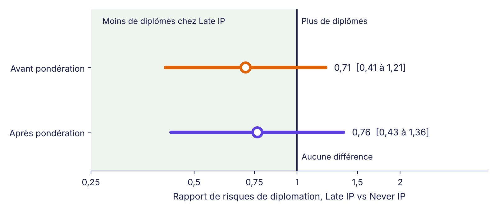

::: {.callout-note}
## La suite de l'histoire de Nadia et Louis
Cet article reprend là où [le premier](../ponderation-trajectoires-pi/index.qmd) s'est arrêté. Les élèves sont toujours les mêmes, inventés comme leurs chiffres, et [le fichier se télécharge ici (CSV)](../ponderation-trajectoires-pi/eleves-simules.csv). Chaque calcul est exact.
:::

::: {.callout-tip}
## Dico express
- **Rapport de risques** : le pourcentage de diplômés d'un groupe divisé par celui d'un autre groupe. Sous 1, le premier groupe compte moins de diplômés.
- **Erreur-type** : une mesure de la variation qu'on observerait si on refaisait l'étude avec d'autres élèves.
- **Intervalle de confiance à 95 %** : la fourchette de valeurs compatibles avec ce que les données ont montré.
- **Régression de Poisson modifiée** : un outil qui permet d'obtenir directement un rapport de risques, même quand on étudie un résultat oui/non comme l'obtention du diplôme.
- **Erreurs-types robustes** : une façon de calculer la marge d'erreur qui reste juste même si le modèle est une approximation.
:::

## Le chiffre qui voulait avoir raison

On croit souvent qu'un calcul, une fois terminé, donne la réponse. Il donne une estimation.

Une semaine après leur première rencontre, Louis revient dans le bureau de Nadia, un café dans chaque main. Il a relu leur dernier tableau.

« Alors, 0,76. Ça veut dire que les élèves de Late IP obtiennent leur diplôme 24 % moins souvent que ceux de Never IP, à profil égal. Je peux l'écrire dans mon rapport? »

Nadia prend son café sans répondre tout de suite.

« Tu peux écrire que c'est notre meilleure estimation. Mais pas encore que c'est la réponse. »

Louis lève un sourcil.

« Pourquoi pas? C'est un calcul exact.

— Le calcul est exact. Mais il repose sur trente élèves, 10 de Late IP et 20 de Never IP. Si on avait suivi trente autres élèves, aurait-on obtenu 0,76 de nouveau? »

## Un autre mardi, d'autres élèves

Nadia prend un crayon.

« Imagine un sondage. On dit qu'un candidat a 52 % des intentions de vote, avec une marge d'erreur de 3 points. Ça ne veut pas dire que le sondeur s'est trompé. Ça veut dire qu'avec un autre échantillon de personnes, il aurait pu trouver 49 % ou 55 %.

— Et pour nous?

— C'est pareil. Mon 0,76 vient de ces trente élèves-là. Avec trente autres, j'aurais peut-être trouvé 0,60. Ou 0,95. La question est de savoir *dans quelle fourchette* le vrai chiffre a des chances de se trouver. »

Cette fourchette porte un nom : l'**intervalle de confiance**. Pour le calculer, Nadia a besoin d'un modèle statistique. Et Louis a une objection.

## « Pourquoi pas une régression logistique? »

Louis a déjà vu des rapports de recherche. Il se souvient de la régression logistique, l'outil classique quand le résultat est oui ou non, comme ici : diplômé ou pas.

« Elle produit un rapport de cotes, pas un rapport de risques, répond Nadia. Et c'est un problème quand le résultat est fréquent. »

Elle écrit les chiffres au tableau.

- Chez Late IP, 60 % obtiennent leur diplôme. La *cote* est de 6 chances contre 4, soit 1,5.
- Chez Never IP pondéré, 78,5 % obtiennent leur diplôme. La cote est de 78,5 contre 21,5, soit 3,65.
- Le rapport de cotes vaut donc 1,5 ÷ 3,65 = **0,41**.

« Regarde. Le rapport de risques disait 0,76. Le rapport de cotes dit 0,41. Même données, mais un écart qui a l'air deux fois plus grand. Quand presque tout le monde réussit, les cotes exagèrent.

— Et on en veut un autre, alors?

— On veut le rapport de risques, celui qui compare directement 60 % et 78,5 %. Il existe une astuce pour l'obtenir avec la marge d'erreur qui va avec : la régression de **Poisson modifiée**. »

Louis fronce les sourcils.

« Poisson? Le modèle des accidents et des appels au centre d'urgence? On compte des diplômés, pas des accidents.

— Le nom est trompeur, je te l'accorde. On emprunte le modèle de Poisson parce qu'il estime directement un rapport. Il suppose cependant que la variabilité des résultats suit une règle qui n'est pas la bonne pour un oui/non. On corrige donc ce défaut au moment de calculer la marge d'erreur, avec ce qu'on appelle les **erreurs-types robustes**, ou « en sandwich ». »

## Le modèle, en trois gestes

Nadia résume son modèle sur une feuille. Il tient en trois gestes.

1. **Une seule variable : le groupe.** Les élèves de Late IP valent 1, ceux de Never IP valent 0.
2. **Le même poids que la dernière fois.** Chaque élève de Late IP compte pour 1. Chaque élève de Never IP compte selon son poids : 1,00 pour Inès, 0,40 pour Malik, 0,75 pour Camille, 0,25 pour Émile.
3. **On lit le résultat à l'envers.** Le modèle travaille avec des logarithmes. Pour revenir au rapport de risques, on les remet à leur place (on prend l'exponentielle).

Voici ce que le modèle donne.

| | Valeur |
|---|:-:|
| Coefficient du groupe (échelle logarithmique) | −0,269 |
| Rapport de risques (exponentielle du coefficient) | **0,76** |
| Erreur-type robuste (échelle logarithmique) | 0,296 |

Louis relève la tête.

« Mais ça fait 0,76, comme avant!

— Évidemment. Avec une seule variable de groupe, le modèle retrouve ce qu'on avait fait à la main : 60 % divisé par 78,5 %. Il n'invente rien. Il ajoute la marge d'erreur. »

## Calculer la marge d'erreur

Nadia dessine une ligne.

« Je calcule d'abord une marge autour du coefficient, sur l'échelle logarithmique : plus ou moins 1,96 fois l'erreur-type. Ensuite je remets tout à l'endroit avec l'exponentielle.

- Limite basse : exp(−0,269 − 1,96 × 0,296) = exp(−0,849) = **0,43**
- Limite haute : exp(−0,269 + 1,96 × 0,296) = exp(0,311) = **1,36** »

Pourquoi passer par les logarithmes? Parce qu'un rapport est symétrique sur cette échelle : 0,5 (moitié moins) et 2 (deux fois plus) sont à égale distance de 1. Sur l'échelle ordinaire, ce n'est pas le cas.

« Mon intervalle de confiance à 95 % va de 0,43 à 1,36. Et regarde où se trouve le chiffre 1. »

Louis regarde la feuille. Le 1 est dans l'intervalle.

{fig-alt="Graphique en points avec intervalles. Avant pondération : 0,71, de 0,41 à 1,21. Après pondération : 0,76, de 0,43 à 1,36. Une ligne verticale à 1 marque l'absence de différence. Les deux intervalles traversent cette ligne."}

## Ce que les données permettent de dire (et de ne pas dire)

« Le 1, c'est le chiffre qui signifie qu'il n'y a aucune différence, dit Nadia. Mon intervalle le contient. Ça veut dire que mes trente élèves sont compatibles avec plusieurs histoires à la fois.

- Histoire 1 : Late IP compte beaucoup moins de diplômés (jusqu'à 57 % de moins, soit 0,43).
- Histoire 2 : il n'y a aucune différence.
- Histoire 3 : Late IP compte un peu plus de diplômés (jusqu'à 36 % de plus, soit 1,36).

— Donc on ne sait rien?

— On sait que notre meilleure estimation est de 24 % de moins. On sait que cette estimation est trop imprécise pour exclure une absence de différence. Et on sait pourquoi : trente élèves, c'est peu. »

Elle montre la première ligne de la figure.

« Avant la pondération, l'intervalle allait de 0,41 à 1,21. Après, de 0,43 à 1,36. La pondération rend l'intervalle un peu plus large. Tu te souviens de la taille effective? Nos 20 élèves de Never IP ne valaient plus que 15,3 élèves pleinement utiles. On a payé la comparaison équitable avec un peu de précision. »

Louis repose son café.

« Alors dans mon rapport?

— Écris que l'estimation va dans le sens d'un écart défavorable à Late IP, mais que la précision est insuffisante pour conclure. Et propose de refaire l'analyse avec beaucoup plus d'élèves. »

## Les pièges à éviter

Nadia connaît bien les erreurs que l'on commet devant un intervalle de confiance.

- **« L'intervalle contient 1, donc il n'y a pas d'effet. »** Non. Il y a seulement trop peu de données pour trancher. L'absence de preuve n'est pas la preuve de l'absence.
- **« L'intervalle exclut 1, donc le PI est la cause. »** Non plus. L'intervalle mesure l'incertitude due au hasard de l'échantillon. Il ne corrige pas les différences que la pondération n'a pas vues, comme celles qu'on n'a pas mesurées.
- **Oublier que les poids ont aussi une incertitude.** Nadia a calculé ses poids à partir des mêmes élèves. Son calcul les traite comme s'ils étaient connus à l'avance, ce qui sous-estime légèrement la marge d'erreur. Dans une vraie analyse, on le vérifie en refaisant tout le calcul sur des échantillons tirés des mêmes données (voir l'encadré ci-dessous).
- **Choisir le modèle après avoir vu le résultat.** Si on essaie dix modèles et qu'on garde celui qui donne l'intervalle voulu, la marge d'erreur ne vaut plus rien. Le modèle se choisit avant.

::: {.callout-note collapse="true"}
## Pour les statisticiens

**Modèle.** log E[Y | G] = β₀ + β₁G, où Y vaut 1 pour les diplômés et G vaut 1 pour Late IP. L'estimation utilise la pseudo-vraisemblance de Poisson pondérée : poids 1 pour Late IP, poids ê_Late(x) ÷ ê_Never(x) pour Never IP. Avec une seule variable binaire, le modèle est saturé et exp(β̂₁) égale le rapport des moyennes pondérées : 0,60 ÷ 0,785 = 0,764.

**Pourquoi Poisson pour un résultat binaire.** Le lien logarithmique donne directement un rapport de risques, sans la non-collapsibilité du rapport de cotes. La variance de Poisson (égale à la moyenne) est mal spécifiée pour un résultat binaire, ce que corrige l'estimateur robuste (sandwich). Référence : Zou (2004), *American Journal of Epidemiology*.

**Variance robuste, calculée à la main.** Pour chaque groupe g, Var(log p̂_g) = Σ wᵢ² (yᵢ − p̂_g)² ÷ (Σ wᵢ yᵢ)².

- Late IP : 2,40 ÷ 36 = 0,0667 (6 diplômés et 4 non-diplômés, poids de 1, p̂ = 0,60).
- Never IP pondéré : 1,285 ÷ 7,85² = 1,285 ÷ 61,62 = 0,0208 (p̂ = 0,785).
- Somme : 0,0875, soit une erreur-type de √0,0875 = 0,296.

**Intervalle et test.** Intervalle de Wald sur l'échelle logarithmique : exp(−0,269 ± 1,96 × 0,296) = [0,43 ; 1,36]. Statistique z = −0,269 ÷ 0,296 = −0,91, soit p ≈ 0,36. Estimateur sans correction de petit échantillon (HC0) ; avec la correction usuelle (HC1), l'erreur-type vaut 0,306 et l'intervalle [0,42 ; 1,39].

**Avant pondération.** Mêmes calculs avec des poids de 1 : 0,60 ÷ 0,85 = 0,71 ; erreur-type = √(0,40 ÷ 6 + 0,15 ÷ 17) = 0,275 ; intervalle [0,41 ; 1,21].

**Limite de l'approche.** L'erreur-type traite les poids comme fixes et ignore l'incertitude due à l'estimation des scores de propension. Une vérification par rééchantillonnage (5 000 tirages avec remise des 30 élèves, scores et poids recalculés à chaque tirage ; 4 734 tirages utilisables) donne un intervalle par percentiles de [0,34 ; 1,40], un peu plus large.
:::

::: {.a-retenir}
**À retenir**

- Un résultat sans marge d'erreur est une demi-réponse. Une estimation vient toujours d'un échantillon précis.
- Pour un résultat oui/non fréquent, la régression de Poisson modifiée donne directement le rapport de risques, alors que le rapport de cotes exagère l'écart (0,41 au lieu de 0,76 ici).
- Intervalle de confiance à 95 % : de 0,43 à 1,36. Il contient 1 : les données ne permettent ni de conclure à un écart, ni de l'exclure.
- « Pas concluant » ne veut pas dire « pas d'effet ». Cela veut dire qu'il faut plus de données.
:::
