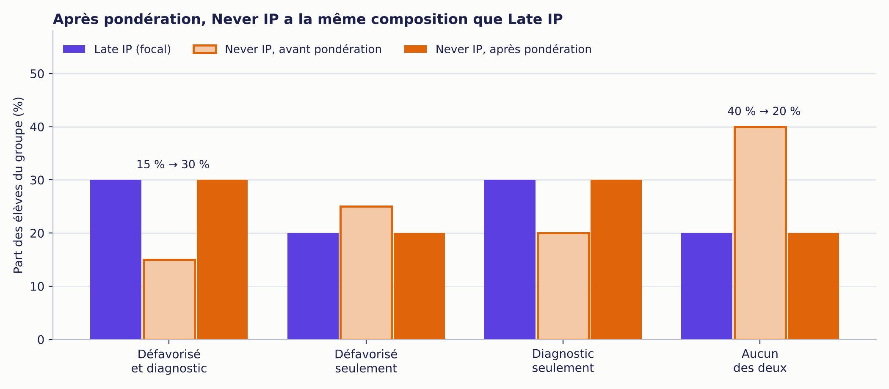
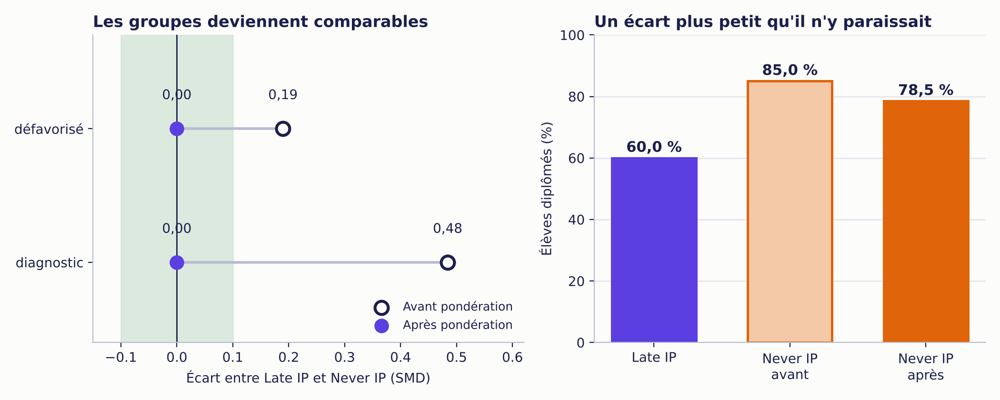

::: {.callout-note}
## Une histoire inventée, des calculs exacts
Nadia, Louis et les 40 élèves de cette histoire n'existent pas. Les chiffres sont fictifs, mais chaque calcul est exact, et la méthode est celle qu'utilisent de vraies recherches. Les données sont assez petites pour tout refaire à la main : [le fichier des 40 élèves se télécharge ici (CSV)](eleves-simules.csv).
:::

## Le chiffre qui dérange

Un jeudi de novembre, Louis entre dans le bureau de Nadia, une feuille à la main. Il coordonne les services aux élèves d'un réseau scolaire, et il a l'air inquiet.

« Regarde ça. »

Nadia est analyste de données. Depuis des mois, elle suit des élèves année après année pour une recherche sur les **plans d'intervention (PI)**, ces documents qui planifient le soutien offert à un élève en difficulté. Elle a regroupé les élèves selon la façon dont leurs PI se succèdent dans le temps. Ces regroupements s'appellent des **trajectoires**. Trois d'entre elles comptent ce jeudi-là :

| Trajectoire | Ce qu'elle décrit |
|---|---|
| **Never IP** | Jamais de PI |
| **Late IP** | Un PI qui arrive tard |
| **Early persistent IP** | Un PI qui arrive tôt et qui dure |

(Il en existe deux autres, Transient IP, un PI transitoire, et Intermediate persistent IP, un PI persistant intermédiaire. Elles obéissent à la même logique.)

Louis pointe deux taux de diplomation, entourés au crayon.

« Parmi les élèves qui n'ont jamais eu de PI (Never IP), 85 % ont obtenu leur diplôme. Parmi ceux dont le PI est arrivé tard (Late IP), seulement 60 %. C'est un écart de 25 points. Si le PI tardif fait chuter la réussite, il faut tout repenser. »

Nadia ne répond pas tout de suite. Elle a déjà vu ce genre de chiffre, et elle l'a déjà vu se retourner contre ceux qui le prenaient au pied de la lettre.

« J'ai deux questions, dit-elle. Ces élèves se ressemblaient-ils au départ? Et sinon, comment comparer ce qui n'est pas comparable? »

Elle griffonne le rapport de risques, ce rapport entre deux taux de diplomation : 0,60 ÷ 0,85 = **0,71**. Un rapport sous 1 signifie moins de diplômés chez Late IP : environ 29 % de moins. Un chiffre spectaculaire, donc suspect.

::: {.callout-tip}
## L'idée de Nadia en une phrase
Repondérer les élèves de Never IP pour que leur composition ressemble, profil par profil, à celle de Late IP. Ensuite seulement, comparer leurs diplômes.
:::

## Quatre sortes d'élèves

Nadia ouvre le dossier : 40 élèves. Pour chacun, deux caractéristiques mesurées au départ, avant que les trajectoires se dessinent :

- **défavorisé** : forte défavorisation, oui ou non;
- **diagnostic** : au moins un diagnostic, oui ou non.

Deux réponses possibles, deux questions : quatre profils. Pour s'y retrouver, elle leur donne des prénoms inventés.

- **Inès** : défavorisée, avec un diagnostic.
- **Malik** : défavorisé, sans diagnostic.
- **Camille** : non défavorisée, avec un diagnostic.
- **Émile** : ni l'un ni l'autre.

Elle compte. Le tableau indique le nombre d'élèves, puis, entre parenthèses, le nombre de diplômés.

| Profil | Late IP | Never IP | Early persistent IP | Total |
|---|:-:|:-:|:-:|:-:|
| Inès (défavorisé et diagnostic) | 3 (1) | 3 (2) | 2 (1) | 8 |
| Malik (défavorisé seulement) | 2 (1) | 5 (4) | 3 (2) | 10 |
| Camille (diagnostic seulement) | 3 (2) | 4 (3) | 2 (2) | 9 |
| Émile (aucun des deux) | 2 (2) | 8 (8) | 3 (3) | 13 |
| **Total** | **10 (6)** | **20 (17)** | **10 (8)** | **40** |

Nadia relit les colonnes une à une, puis relève la tête.

« Chez Late IP, trois élèves sur dix sont des Inès. Chez Never IP, seulement trois sur vingt. Et les Émile, ceux qui ont tout pour réussir? Quatre sur dix chez Never IP, deux sur dix chez Late IP. »

| Caractéristique | Late IP | Never IP |
|---|:-:|:-:|
| Défavorisé | 50 % | 40 % |
| Diagnostic | 60 % | 35 % |

« Tu compares deux photos de classe qui ne se ressemblent pas, dit-elle à Louis. Ton écart de 25 points mélange deux choses : l'effet possible du PI, et l'effet de qui se trouve dans chaque photo. Les statisticiens appellent ça la **confusion**. »

## Une photo à retoucher

Nadia prend une décision qui structure tout le reste.

**Late IP sera son groupe focal.** Ses élèves restent tels quels : chacun compte pour une voix entière, soit un poids de 1. **Never IP sera le groupe comparé.** C'est sa photo qu'elle va retoucher, pour qu'elle ressemble à celle de Late IP.

Dans le jargon de l'équipe, cette comparaison s'écrit « **Late IP vs Never IP** » : d'abord le groupe focal, ensuite le groupe comparé. La question devient : **comment les élèves de Late IP auraient-ils réussi s'ils n'avaient jamais eu de PI?**

Les élèves de Never IP qui ressemblent à ceux de Late IP compteront davantage. Les autres compteront moins. Mais de combien? Pour le savoir, Nadia doit répondre à une question étrange.

## La chance d'être là où l'on est

Elle demande à chaque profil : *quelle chance avait un élève comme toi de se retrouver dans chaque trajectoire?* Dans ce petit jeu de données, la réponse est une simple proportion. Sur les 8 Inès, 3 sont en Late IP : 3 ÷ 8 = 37,5 %. Les statisticiens appellent ce nombre le **score de propension**.

| Profil | Chance d'être en Late IP | en Never IP | en Early persistent IP |
|---|:-:|:-:|:-:|
| Inès | 0,375 | 0,375 | 0,250 |
| Malik | 0,200 | 0,500 | 0,300 |
| Camille | 0,333 | 0,444 | 0,222 |
| Émile | 0,154 | 0,615 | 0,231 |

« Regarde Émile, dit Nadia. Il n'a que 15,4 % de chances de se retrouver en Late IP, mais 61,5 % de chances d'être en Never IP. Les Émile peuplent Never IP. Et les Inès, eux, y sont rares. »

## Baisser le volume des Émile

Nadia sait maintenant ce qu'elle cherche : pour chaque élève de Never IP, un poids qui mesure à quel point son profil est plus fréquent chez Late IP que chez Never IP. Le calcul tient en une ligne :

**poids = chance d'être en Late IP ÷ chance d'être en Never IP**

| Profil | Calcul | Poids | Élèves Never IP | Poids total |
|---|:-:|:-:|:-:|:-:|
| Inès | 0,375 ÷ 0,375 | 1,00 | 3 | 3,0 |
| Malik | 0,200 ÷ 0,500 | 0,40 | 5 | 2,0 |
| Camille | 0,333 ÷ 0,444 | 0,75 | 4 | 3,0 |
| Émile | 0,154 ÷ 0,615 | 0,25 | 8 | 2,0 |
| **Total** | | | **20** | **10,0** |

Chaque Inès de Never IP compte pour une voix entière. Chaque Émile, pour le quart d'une voix.

« Donc tu fais taire les Émile, dit Louis.

— Je baisse leur volume. Il y en a beaucoup dans Never IP et peu dans Late IP : ils déforment la photo. »

Elle additionne les poids : **10,0**. C'est exactement l'effectif de Late IP. Never IP repondéré « pèse » autant que Late IP, comme prévu. Premier signe que le calcul tient la route.

## Le contre-interrogatoire

Nadia a appris à se méfier de ses propres résultats. Une pondération n'est pas une preuve. Avant de croire quoi que ce soit, elle la soumet à trois questions.

### Y a-t-il des jumeaux?

Pour chaque type d'élève de Late IP, il doit exister des élèves semblables dans Never IP. Sinon, la pondération n'a personne à qui donner du poids : elle ne peut pas inventer des élèves qui n'existent pas.

Ici, les quatre profils existent dans les deux groupes. **Aucun élève de Late IP n'est sans jumeau** : 0 % d'élèves hors de la zone de comparaison.

### Combien d'élèves restent vraiment?

Des poids inégaux font perdre de l'information : une voix qui compte pour le quart d'une autre en dit moins. Les 20 élèves de Never IP équivalent à **15,3 élèves** « pleinement utiles ». Le calcul : (somme des poids)² ÷ somme des carrés des poids = 10² ÷ 6,55 = 15,3.

Autre inquiétude : qu'un seul élève pèse trop lourd. Ici, le poids le plus élevé représente 10 % du total. Dans une vraie étude, on s'inquiéterait dès 5 %. Mais avec seulement 20 élèves à pondérer, c'est inévitable : un élève sur vingt pèse déjà 5 %. Nadia a volontairement choisi un petit exemple pour que tout reste calculable à la main. Dans la vraie vie, il faut beaucoup plus d'élèves par groupe.

### Les deux photos se ressemblent-elles enfin?

Pour mesurer l'écart entre deux groupes sur une caractéristique, Nadia utilise la **différence moyenne standardisée (SMD)** : l'écart entre les moyennes, divisé par l'écart-type du groupe focal. Sous 0,10, on considère les groupes comparables.

| Caractéristique | Moyenne Late IP | Moyenne Never IP avant | Moyenne Never IP après | SMD avant | SMD après |
|---|:-:|:-:|:-:|:-:|:-:|
| Défavorisé | 0,50 | 0,40 | 0,50 | **0,19** | **0,00** |
| Diagnostic | 0,60 | 0,35 | 0,60 | **0,48** | **0,00** |

Les deux écarts tombent à zéro. La photo de Never IP ressemble maintenant à celle de Late IP :

{fig-alt="Graphique à barres groupées pour quatre profils d'élèves. Avant pondération, Never IP compte 15 % d'élèves défavorisés avec diagnostic et 40 % d'élèves sans aucun des deux facteurs. Après pondération, Never IP compte 30 % et 20 %, comme Late IP."}

## Le verdict

Maintenant seulement, Nadia compare les diplômes. Elle calcule le nombre pondéré de diplômés dans Never IP : 2 Inès diplômées × 1,00 + 4 Malik × 0,40 + 3 Camille × 0,75 + 8 Émile × 0,25 = 2 + 1,6 + 2,25 + 2 = **7,85**. Divisé par la somme des poids (10), cela donne **78,5 %** de diplômés.

Le rapport de risques devient : 0,60 ÷ 0,785 = **0,76**.

| | Avant (sans pondération) | Après (Never IP pondéré) |
|---|:-:|:-:|
| Défavorisés, Late vs Never | 50 % vs 40 % | 50 % vs 50 % |
| Diagnostic, Late vs Never | 60 % vs 35 % | 60 % vs 60 % |
| SMD défavorisé / diagnostic | 0,19 / 0,48 | 0,00 / 0,00 |
| Composition de Never IP (Inès / Malik / Camille / Émile) | 15 % / 25 % / 20 % / 40 % | 30 % / 20 % / 30 % / 20 % |
| Diplômés dans Never IP | 85 % | 78,5 % |
| **Rapport de risques (Late IP vs Never IP)** | **0,71** | **0,76** |
| Taille effective de Never IP | 20 élèves | 15,3 élèves équivalents |

{fig-alt="À gauche, l'écart standardisé pour défavorisé passe de 0,19 à 0 et pour diagnostic de 0,48 à 0 après pondération. À droite, 60 % de diplômés dans Late IP contre 85 % dans Never IP avant pondération et 78,5 % après."}

Nadia retourne voir Louis.

« Alors, le PI tardif ne nuit pas?

— Je n'ai pas dit ça. J'ai dit qu'une partie de l'écart était un mirage. Avant, Late IP avait un taux de diplomation inférieur d'environ 29 % à celui de Never IP. Entre des élèves de même profil, il l'est d'environ 24 %. »

Louis fronce les sourcils. « Il reste donc un écart.

— Oui. À profil égal, et sur ce que j'ai pu mesurer : la défavorisation et le diagnostic. Je ne peux pas dire que le PI en est la cause. Un PI qui arrive tard signale peut-être des difficultés apparues tard, et ça, aucune de mes deux cases ne le capte. »

::: {.callout-note}
## Comment lire le résultat
La comparaison corrigée est plus juste que la comparaison brute, mais elle décrit une **association à profil égal, sur les caractéristiques mesurées**. Elle ne prouve pas que le PI cause l'écart restant.
:::

Louis range sa feuille. L'accusation de départ n'est plus aussi solide, mais l'enquête n'est pas close. Dans le prochain article, Nadia s'attaquera à la suite : estimer l'écart qui reste et mesurer sa marge d'incertitude.

## Un deuxième suspect

Nadia ne s'arrête pas là. Et si elle comparait Late IP à Early persistent IP, un PI précoce et durable?

Bonne nouvelle : le score de propension, lui, ne change pas. Un même calcul sert pour toutes les comparaisons. Seul le groupe comparé change, et donc les poids : chance d'être en Late IP ÷ chance d'être en Early persistent IP. Ils valent **1,50** pour les élèves avec un diagnostic (Inès et Camille) et **0,67** pour les autres (Malik et Émile). Leur somme vaut encore 10, l'effectif de Late IP.

## Là où l'enquête peut dérailler

Nadia connaît les limites de sa méthode, et elles valent pour toute vraie étude :

- **Le chevauchement manquant.** Imaginez qu'il n'y ait aucune Inès dans Never IP. Leur chance d'y être vaudrait 0 : leur poids exigerait une division par zéro. Les 3 Inès de Late IP n'auraient aucun jumeau, et on ne pourrait rien dire sur ce qu'elles auraient obtenu sans PI. En vraies données, le cas est plus nuancé, mais le principe reste le même.
- **Les poids extrêmes.** Quelques élèves qui comptent pour beaucoup peuvent dominer le résultat. Une pratique courante consiste à plafonner les poids les plus élevés à la valeur du 99e centile, c'est-à-dire à la valeur sous laquelle se trouvent 99 % des poids. Ici, le plus grand poids vaut 1,00 : rien à plafonner.
- **Le score ne corrige que ce qu'on a mesuré.** Nadia a deux caractéristiques ici. Ce qui n'est pas dans les données ne peut pas être rééquilibré.
- **Un équilibre parfait n'est pas une preuve de causalité.** Des groupes qui se ressemblent sur les variables mesurées peuvent encore différer sur autre chose.

::: {.callout-note collapse="true"}
## Pour les statisticiens

**Estimand.** Ces poids estiment l'effet moyen chez les élèves du groupe focal X (ATT). Les élèves de X gardent un poids de 1, ceux du groupe comparé Y reçoivent le rapport e_X(x) ÷ e_Y(x). Avec plusieurs trajectoires, les scores e_k(x) = P(T = k | x) viennent d'un seul modèle multinomial; chaque comparaison n'utilise que les deux scores de la paire.

**Pourquoi ce poids (règle de Bayes).** Pour que Y ressemble à X, un élève de Y de profil x doit compter comme P(x | X) ÷ P(x | Y). Par Bayes, P(x | k) = e_k(x) × P(x) ÷ P(k). Dans le rapport, P(x) s'annule : il reste e_X(x) ÷ e_Y(x), multiplié par la constante P(Y) ÷ P(X), identique pour tous les élèves. On la retire : elle s'annule dans les moyennes pondérées, qui divisent par la somme des poids. Sans elle, la somme des poids de Y égale l'effectif de X. Vérification pour Malik : e_Late = 2 ÷ 10, e_Never = 5 ÷ 10; P(x | Late) = 2 ÷ 10 = 0,20; P(x | Never) = 5 ÷ 20 = 0,25; le rapport des parts vaut 0,80, soit 0,40 × 2, où 2 = P(Never) ÷ P(Late) = 20 ÷ 10.

**Chevauchement.** On compare l'étendue du score par paire e_X ÷ (e_X + e_Y) dans les deux groupes. Ici : 0,50 (Inès), 0,29 (Malik), 0,43 (Camille), 0,20 (Émile). Un élève de X dont le score dépasse tous ceux de Y est hors support.

**Taille effective (Kish).** ESS = (Σw)² ÷ Σw². Ici : 10² ÷ 6,55 = 15,3.

**SMD.** Différence des moyennes (pondérée pour Y), divisée par l'écart-type du groupe focal, le même avant et après. Seuil usuel : 0,10. Pour une proportion p dans un groupe de n élèves : √(n ÷ (n − 1) × p × (1 − p)), soit 0,527 pour Défavorisé (p = 0,5, n = 10). Le choix de l'écart-type du groupe focal (plutôt que d'un écart-type regroupé) suit l'usage pour l'ATT : le dénominateur reste le même avant et après pondération. Références : Stuart (2010), *Statistical Science*, section 4.1; Stuart, Lee et Leacy (2013), *Journal of Clinical Epidemiology*; documentation du paquet R `cobalt` (argument `s.d.denom`, « treated » pour l'ATT).

**Ce que la vraie analyse ajoute.** Un modèle multinomial à effets principaux avec de nombreuses covariables, continues et binaires, mesurées au départ; cinq trajectoires comparées à partir d'un seul modèle; des vérifications strictes (effectifs minimaux, chevauchement, taille effective, SMD sous 0,10). L'estimation de l'écart une fois les élèves pondérés fera l'objet d'un prochain article.
:::

::: {.a-retenir}
**À retenir**

- Comparer deux groupes qui ne se ressemblent pas au départ mélange l'effet de la trajectoire et celui des profils.
- Le groupe focal garde un poids de 1. Le groupe comparé est repondéré pour lui ressembler.
- Une pondération se vérifie toujours : jumeaux, taille effective, équilibre (SMD sous 0,10).
- Ici, le rapport de risques passe de 0,71 à 0,76 : une partie de l'écart venait des profils de départ, mais il en reste une.
:::
